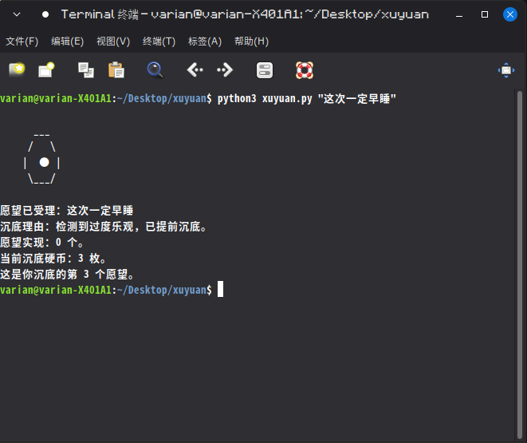

# xuyuan

一个只收愿望、不办事的许愿池。

愿望实现率永远 0%。硬币必沉底。



## 直接运行（零安装）

```bash
python3 xuyuan.py "暴富"
python3 xuyuan.py "老板明天请假"
python3 xuyuan.py stats
python3 xuyuan.py sink
python3 xuyuan.py reset
```

也可以先加执行权限：

```bash
chmod +x xuyuan.py
./xuyuan.py "暴富"
./xuyuan.py stats
```

## 可选：装成短命令 `xy` / `xuyuan`

想敲 `xy` 的话，软链两个名字到同一份脚本：

```bash
chmod +x xuyuan.py
mkdir -p ~/.local/bin

ln -sf "$(pwd)/xuyuan.py" ~/.local/bin/xy
ln -sf "$(pwd)/xuyuan.py" ~/.local/bin/xuyuan
```

确保 `~/.local/bin` 在 PATH：

```bash
echo 'export PATH="$HOME/.local/bin:$PATH"' >> ~/.zshrc
source ~/.zshrc
```

然后 `xy` 和 `xuyuan` 完全等价：

```bash
xy "暴富"
xuyuan "老板明天请假"
xy stats
xy sink
xy reset
```

不想动 `~/.local/bin`，用 alias 也行：

```bash
alias xy='python3 /你的路径/xuyuan.py'
```

装不装软链不影响功能，只影响命令长短。理由库通过脚本所在目录查找，软链安装也能找到，不用复制 `reasons.txt`。

## 示例

```text
$ python3 xuyuan.py "暴富"
      ___
     /   \
    |  ●  |
     \___/

愿望已受理：暴富
沉底理由：愿望太重，沉了。
愿望实现：0 个。
当前沉底硬币：1 枚。
这是你沉底的第 1 个愿望。
```

```text
$ python3 xuyuan.py "这次一定早睡"
      ___
     /   \
    |  ●  |
     \___/

愿望已受理：这次一定早睡
沉底理由：检测到过度乐观，已提前沉底。
愿望实现：0 个。
当前沉底硬币：12 枚。
这是你沉底的第 12 个愿望。
```

```text
$ python3 xuyuan.py stats
你已许愿 8 次。
硬币沉底 8 枚。
愿望实现 0 个。
沉底率：100.0%
池子评价：池子表示情绪稳定。
最近一个愿望：暴富（已沉底）
```

```text
$ python3 xuyuan.py sink
最近沉底记录：
1. 暴富    理由：愿望太重，沉了。
2. 老板明天请假    理由：池子审批通过：同意沉底。
3. 早点睡    理由：池子听懂了，但池子不想动。
池底累计：3 枚硬币，0 个愿望。
```

## 理由库

所有沉底理由在 `reasons.txt`，一行一条，`#` 开头是注释。  
支持 `{n}` 占位符，会被替换成你许愿的次数。

加理由直接编辑 `reasons.txt`，提 PR 也行。  
规矩只有一条：理由是沉的，不是实现的。

## 本项目不做什么

- 不实现愿望
- 不分析愿望
- 不联网
- 不道歉
- 不承认“没用”是缺点

## 状态

愿望和统计只存在本地 `~/.xuyuan.json`，不上传，不收集，不分析。

## License

WTFPL
